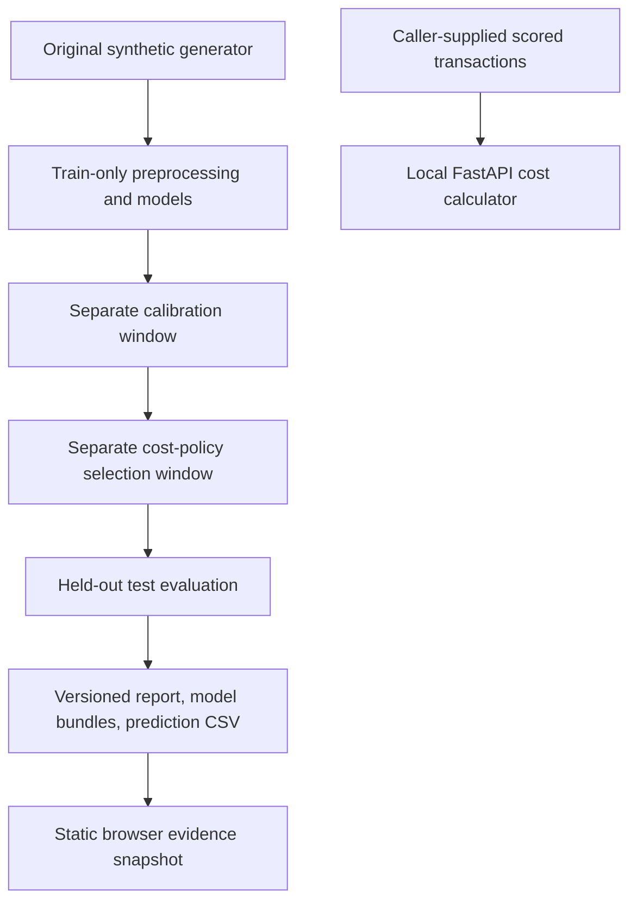

> **Netlify deployment:** [https://fraudlens-poojan-desai.netlify.app](https://fraudlens-poojan-desai.netlify.app). See [NETLIFY.md](NETLIFY.md) for the current hosting commands; older Sites-specific instructions below are historical.

# FraudLens

FraudLens is an explainable credit-card fraud strategy simulator. It goes beyond ranking transactions: it helps an analyst choose a decision threshold that balances missed fraud, false-positive customer friction, manual-review expense, and review-team capacity.

The project is designed for Credit & Fraud Risk internship interviews. Its central question is not “Which model has the highest accuracy?” but “Which decision policy minimizes financial damage while remaining explainable and operationally feasible?”

## What is working

- Browser threshold and cost analysis from **actual trained-model probabilities on 11,250 held-out synthetic transactions**, exported as a small precomputed study snapshot
- Separate, disjoint train / probability-calibration / cost-policy-selection / test windows; test results never choose a policy or model champion
- Calibrated Logistic Regression and XGBoost; precision, recall, F1, average precision, ROC-AUC, confusion matrix, false-positive rate, review workload, Brier score, calibration bins and threshold-dependent business cost
- Explicit cost assumptions, selection-only policy button, downloadable evidence and real precision–recall curve points
- Eight searchable authored transaction examples and six instant authored attack comparisons, labeled separately from model evaluation
- Deterministic synthetic generator; dataset/config/source hashes, actual model parameters and package versions, immutable artifact directories and prediction CSVs
- Local FastAPI strategy-cost API and SQLAlchemy schema; no hosted Python/model inference service is implied by the static demo
- Backend/frontend regression tests and local production build; CI workflow added (not yet run remotely)

## Architecture



The SQLite tables are a storage foundation; no browser-to-database review workflow is implied. The real benchmark has a separate download/schema-validation helper, not a completed experiment in this slice.


## Data design

The two datasets have different jobs:

1. **Real benchmark download path** can obtain and validate a standard imbalanced fraud benchmark; no completed benchmark training result is claimed. The `V1`–`V28` fields are anonymized, so they are not ideal for recruiter-facing explanations.
2. **Synthetic strategy data** is clearly labeled as simulated and includes readable fields: amount, merchant category, country, distance from home, transaction velocity, average 30-day amount, amount ratio, device status, card-present status, account age, international status, and prior declines.

Raw data, generated CSVs, database files, and trained model artifacts are intentionally excluded from Git. They are reproducible with the included scripts.

## Current reproducible study

Configuration: [`configs/synthetic-v2.json`](configs/synthetic-v2.json). The original generator creates 75,000 synthetic transactions with seed 42 (823 fraud labels). Strict chronological windows are **45,000 train / 11,250 calibration / 7,500 policy selection / 11,250 test**. Each window contains both classes; duplicate or missing timestamps fail closed. The generator is stationary, so chronology alone does not demonstrate real-world temporal generalization.

Both models fit preprocessing and model weights only on train, then fit a sigmoid calibrator only on calibration. Hyperparameters are fixed in advance. Each threshold minimizes the configured financial cost on **selection only** over 0.01–0.99; costs round to cents (half upward, tiny summation tolerance), and ties prefer the higher threshold. Test is used only for final metrics and clearly labeled sensitivity exploration. Changing browser costs recalculates the policy from selection aggregates, never a test optimum.

Local run on Apple M3 Pro/macOS 14.4, Python 3.13.1:

| Model | Selection threshold | Test precision | Test recall | Test F1 | Test AP | Test ROC-AUC | Brier score | Test-window cost |
|---|---:|---:|---:|---:|---:|---:|---:|---:|
| Calibrated XGBoost | 0.18 | 62.96% | 13.28% | 0.21935 | 0.24078 | 0.83140 | 0.01027 | $6,108.56 |
| Calibrated Logistic Regression | 0.32 | 54.55% | 9.38% | 0.16000 | 0.21135 | 0.85695 | 0.00998 | $6,489.69 |

“PR-AUC” in the interface means sklearn **average precision**, not trapezoidal integration. Test prevalence is 128/11,250 = 1.14%; accuracy alone would conceal missed fraud. Lower Brier scores are better. The models trade off ranking, calibration and cost; no overall champion is declared using test data. Historical three-window figures were replaced because they did not reproduce exactly with current source/dependencies, and because the prior script selected F1 rather than its documented cost objective.

The current study snapshot is [`public/evaluation.json`](public/evaluation.json). Two full runs on the same environment produced identical snapshot and prediction CSV bytes. Run identity includes dataset, configuration, Python/package/platform and training-source fingerprints; changing these creates a different study directory. Timings and serialized model hashes are recorded in the local report, excluded from the deterministic browser snapshot. No cross-environment bitwise guarantee, uncertainty interval or real-payment benchmark result is claimed.

## Repository layout

```text
fraudlens/
├── app/                     # React/Next.js static dashboard
├── lib/strategy.ts          # Browser strategy-cost engine
├── backend/
│   ├── app/
│   │   ├── ml/              # generation, validation, training, SHAP formatting
│   │   ├── services/        # financial decision engine
│   │   ├── database.py      # SQLAlchemy session
│   │   ├── models.py        # SQLite tables
│   │   └── main.py          # FastAPI endpoints
│   ├── tests/
│   └── requirements.txt
├── data/                    # raw, processed, and synthetic placeholders
├── artifacts/               # generated joblib models and metrics
├── scripts/                 # dataset and training commands
├── tests/                   # frontend strategy and rendered-page tests
├── PROJECT_STATUS.md
└── docker-compose.yml
```

## Run locally

### Dashboard

```bash
npm install
npm run dev
```

### FastAPI and SQLite

```bash
python -m venv .venv
source .venv/bin/activate
pip install -r backend/requirements.txt
uvicorn backend.app.main:app --reload --port 8000
```

OpenAPI documentation is available at `http://localhost:8000/docs`.

### Generate data and train models

```bash
PYTHONPATH=. python scripts/generate_synthetic.py
PYTHONPATH=. python scripts/run_experiment.py --snapshot public/evaluation.json
```

Full evidence and model bundles are written under `artifacts/runs/<study-id>/`: `report.json`, `config.json`, `test_predictions.csv`, `logistic_regression.joblib`, and `xgboost.joblib`. Existing run directories are immutable; use another output directory for a deliberate repeat:

```bash
PYTHONPATH=. python scripts/run_experiment.py --output artifacts/repeat --snapshot work/evaluation-repeat.json
cmp public/evaluation.json work/evaluation-repeat.json
```

Verify a saved study before using its reported results:

```bash
PYTHONPATH=. python scripts/verify_experiment.py artifacts/runs/<study-id>
```

The verifier checks configuration, prediction and model-file hashes, study identity,
test row counts, timestamps and probability bounds, then recomputes reported
held-out metrics and all 99 test-threshold curve points from the prediction CSV.
It never loads executable model pickles.
These unsigned hashes detect accidental corruption; they do not establish who
created a report, validate raw source data, or rerun calibration/policy selection.
CI now includes saved-study verification after training; this workflow change has
not run remotely.

The old `scripts/train_models.py` remains a **legacy three-window F1 study** and does not generate the browser snapshot. Do not mix its artifacts or thresholds with the four-window study.

To download the real benchmark through OpenML data ID `1597`:

```bash
PYTHONPATH=. python scripts/download_real_dataset.py
```

The download script validates all `V1`–`V28`, `Time`, `Amount`, and binary `Class` fields before writing `data/raw/creditcard.csv`.

## Test and verify

```bash
npm test
PYTHONPATH=. pytest -q backend/tests
npm run lint
```

For repeatable browser checks, install Google Chrome, build the app, and serve the exported `out` directory on port 4176. In another terminal:

```bash
python3 -m http.server 4176 --bind 127.0.0.1 --directory out
# In a second terminal:
npm run test:browser
```

The browser script uses an isolated headless Chrome profile through pinned `playwright-core`, verifies 320/390/768/1440px layouts and core interactions, and writes screenshots/results to ignored `work/browser-check/`. Override `FRAUDLENS_BROWSER_URL`, `FRAUDLENS_BROWSER_EXECUTABLE` or `FRAUDLENS_BROWSER_OUTPUT` when needed. It neither uses the user’s signed-in browser profile nor downloads a browser automatically.

Tests cover bounded probabilities, threshold monotonicity, financial cost calculations, attack responses, API validation, deterministic generation, chronological splitting, schema validation, and explanation formatting.

October 24 local verification: 32 backend tests and seven frontend tests passed,
along with lint and the static production build. Added regressions detect modified
prediction/config/model files, altered report metrics, nonfinite API amounts, and
half-cent API/study rounding disagreement. Total costs now use the same documented
half-up cent rule in the API, experiment and browser.

## Cost engine

```text
missed fraud loss = false-negative dollars × (1 − recovery rate)
false-positive cost = legitimate declines × (decline cost + friction cost)
review cost = min(flagged transactions, review capacity) × manual review cost
total strategy cost = missed fraud loss + false-positive cost + review cost + capacity overflow
```

This is a portfolio simulation, not a production authorization system. Synthetic transactions are labeled in the interface, explanations describe model behavior rather than causation, and no payment-card data is collected.

## Demonstration

1. Read the held-out synthetic-study and selection-window disclosures.
2. Move the threshold and inspect the actual test confusion matrix and cost changes.
3. Change cost assumptions, then apply the policy chosen on the separate selection window.
4. Open **Inspect reproducible evaluation evidence** for calibration bins, additional metrics, limitations, study hashes and JSON download.
5. Inspect an authored transaction or evaluate an authored attack example. These are explicitly separate from actual model prediction/SHAP evidence.

## Remaining boundaries

- The Netlify demo is static and precomputed. It does not run training or serve live model inference.
- Browser transaction details and attack scores remain authored. The Python Tree SHAP helper exists and was exercised locally, but raw-model log-odds contributions must not be presented as calibrated-probability explanations.
- No persisted analyst review/notes workflow, monitoring run history, real-data benchmark, authentication, or production payment integration exists.
- Review capacity applies to the whole shown evaluation window, not a daily rate; costs are assumptions, not observed operational losses.
- Docker dashboard hostname/port configuration was corrected; a full container build/run remains unverified where Docker is unavailable.
- The CI workflow is committed for review, but no remote workflow run is claimed before push authorization.
- Next was upgraded from 16.2.6 to 16.3.8 and the critical advisory cleared. Dependency audit still reports 31 affected packages (22 high, eight moderate, one low), largely inherited tooling; this is unresolved security debt. Install-time audit notices are enabled.

## Resume bullet

**FraudLens — Explainable Fraud Strategy Simulator:** Built a full-stack fraud risk decision platform with Python, FastAPI, React, SQL, calibrated XGBoost, and Logistic Regression; developed time-based transaction pipelines, SHAP-ready explanations, and an interactive cost-optimization simulator quantifying missed-fraud loss, false-positive customer friction, and review capacity.
