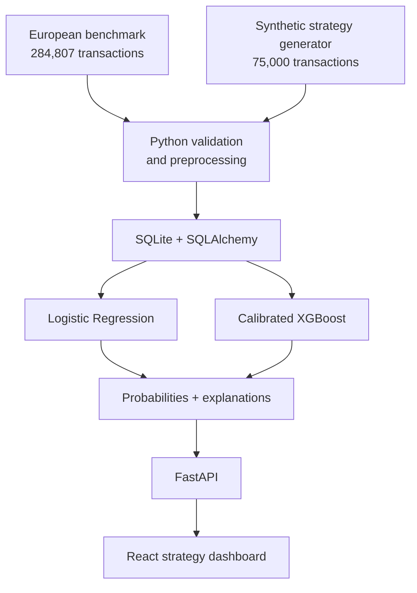

# FraudLens

FraudLens is an explainable credit-card fraud strategy simulator. It goes beyond ranking transactions: it helps an analyst choose a decision threshold that balances missed fraud, false-positive customer friction, manual-review expense, and review-team capacity.

The project is designed for Credit & Fraud Risk internship interviews. Its central question is not “Which model has the highest accuracy?” but “Which decision policy minimizes financial damage while remaining explainable and operationally feasible?”

## What is working

- Interactive threshold simulator with live precision, recall, confusion matrix, fraud loss, legitimate declines, and total strategy cost
- Adjustable decline cost, review cost, fraud recovery rate, and daily review capacity
- Searchable transaction explorer with business-readable SHAP-style explanations
- Logistic Regression and calibrated XGBoost comparison on the same chronological holdout set
- Precision–recall visualization for the imbalanced fraud class
- Six executable attack patterns: card testing, velocity burst, account takeover, impossible travel, dormant card, and merchant anomaly
- Deterministic 75,000-row synthetic strategy generator with readable features and a 1.10% fraud rate
- OpenML benchmark download and schema-validation path for the 284,807-row European dataset
- FastAPI service, SQLAlchemy/SQLite schema, strategy-cost engine, and API validation
- Frontend unit tests, backend tests, linting, and production-build verification

## Architecture



## Data design

The two datasets have different jobs:

1. **Real benchmark data** establishes that the pipeline handles severe class imbalance and a standard fraud benchmark. The `V1`–`V28` fields are anonymized, so they are not ideal for recruiter-facing explanations.
2. **Synthetic strategy data** is clearly labeled as simulated and includes readable fields: amount, merchant category, country, distance from home, transaction velocity, average 30-day amount, amount ratio, device status, card-present status, account age, international status, and prior declines.

Raw data, generated CSVs, database files, and trained model artifacts are intentionally excluded from Git. They are reproducible with the included scripts.

## Model results

The committed interface uses metrics produced by the reproducible synthetic pipeline—not invented 99% accuracy claims. With seed `42`, 75,000 transactions, and a 70%/15%/15% chronological split:

| Model | Precision | Recall | F1 | PR-AUC | Cost-aware threshold | Test strategy cost |
| --- | ---: | ---: | ---: | ---: | ---: | ---: |
| Calibrated XGBoost | 51.7% | 24.2% | 33.0% | 0.249 | 0.18 | $5,746 |
| Logistic Regression | 50.0% | 14.8% | 22.9% | 0.231 | 0.97 | $5,805 |

The fraud prevalence is about 1.10%, so PR-AUC is intentionally emphasized over accuracy. Thresholds are selected on the validation window; the final table is measured once on the untouched test window.

## Repository layout

```text
fraudlens/
├── app/                     # React/Vinext dashboard
├── lib/strategy.ts          # Browser strategy-cost engine
├── backend/
│   ├── app/
│   │   ├── ml/              # generation, validation, training, SHAP formatting
│   │   ├── services/        # financial decision engine
│   │   ├── database.py      # SQLAlchemy session
│   │   ├── models.py        # SQLite tables
│   │   └── main.py          # FastAPI endpoints
│   ├── tests/
│   └── requirements.txt
├── data/                    # raw, processed, and synthetic placeholders
├── artifacts/               # generated joblib models and metrics
├── scripts/                 # dataset and training commands
├── tests/                   # frontend strategy and rendered-page tests
├── PROJECT_STATUS.md
└── docker-compose.yml
```

## Run locally

### Dashboard

```bash
npm install
npm run dev
```

### FastAPI and SQLite

```bash
python -m venv .venv
source .venv/bin/activate
pip install -r backend/requirements.txt
uvicorn backend.app.main:app --reload --port 8000
```

OpenAPI documentation is available at `http://localhost:8000/docs`.

### Generate data and train models

```bash
PYTHONPATH=. python scripts/generate_synthetic.py
PYTHONPATH=. python scripts/train_models.py
```

To download the real benchmark through OpenML data ID `1597`:

```bash
PYTHONPATH=. python scripts/download_real_dataset.py
```

The download script validates all `V1`–`V28`, `Time`, `Amount`, and binary `Class` fields before writing `data/raw/creditcard.csv`.

## Test and verify

```bash
npm test
PYTHONPATH=. pytest -q backend/tests
npm run lint
```

Tests cover bounded probabilities, threshold monotonicity, financial cost calculations, attack responses, API validation, deterministic generation, chronological splitting, schema validation, and explanation formatting.

## Cost engine

```text
missed fraud loss = false-negative dollars × (1 − recovery rate)
false-positive cost = legitimate declines × (decline cost + friction cost)
review cost = min(flagged transactions, review capacity) × manual review cost
total strategy cost = missed fraud loss + false-positive cost + review cost + capacity overflow
```

This is a portfolio simulation, not a production authorization system. Synthetic transactions are labeled in the interface, explanations describe model behavior rather than causation, and no payment-card data is collected.

## 60-second demo

1. **0–10 seconds:** “FraudLens shows how a card company balances fraud prevention against customer friction.”
2. **10–25 seconds:** Move the threshold from `0.80` to `0.35`; point out the change in recall, missed fraud, and legitimate declines.
3. **25–40 seconds:** Apply the cost-minimizing threshold and compare calibrated XGBoost with Logistic Regression.
4. **40–50 seconds:** Open transaction `FL-290874` and explain its strongest risk-increasing and risk-reducing factors.
5. **50–60 seconds:** Run the account-takeover attack, then raise the threshold and show how a policy can miss a plausible attack.

## Resume bullet

**FraudLens — Explainable Fraud Strategy Simulator:** Built a full-stack fraud risk decision platform with Python, FastAPI, React, SQL, calibrated XGBoost, and Logistic Regression; developed time-based transaction pipelines, SHAP-ready explanations, and an interactive cost-optimization simulator quantifying missed-fraud loss, false-positive customer friction, and review capacity.
