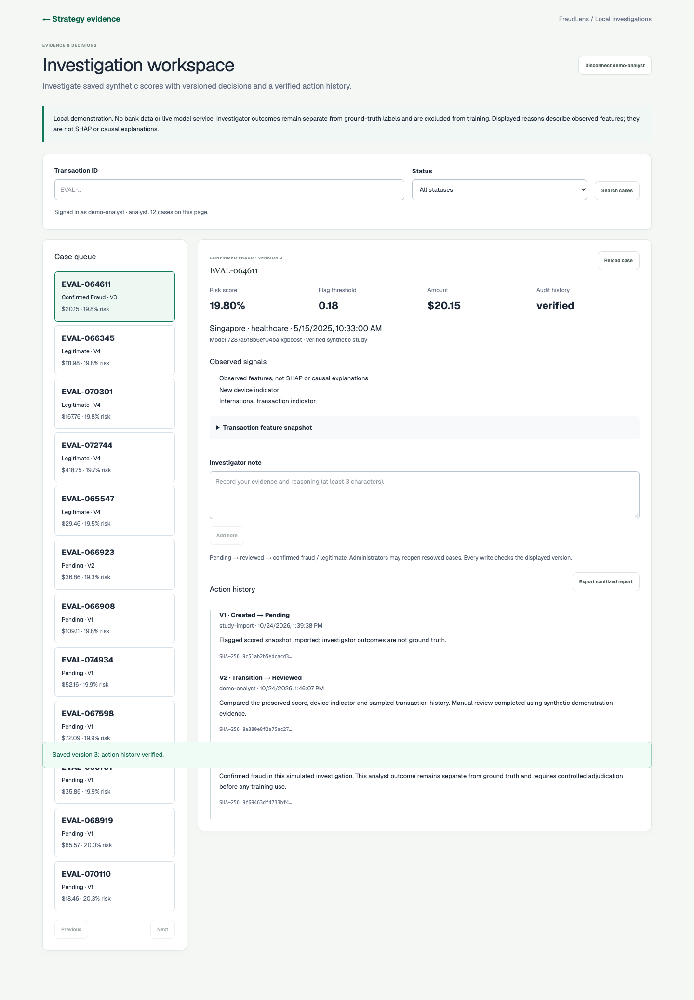
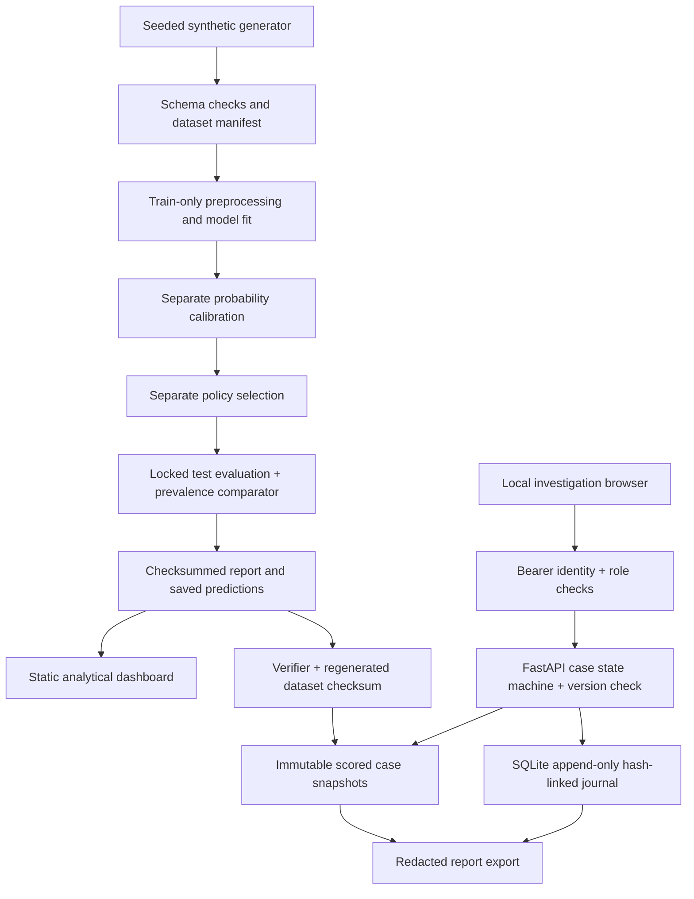

# FraudLens

FraudLens is a local fraud investigation and model-evaluation demonstration using
**synthetic financial transactions**. It connects reproducible calibrated model
scores to analyst review, concurrency-safe decisions and verifiable action history.
I built it to explore how fraud decisions combine statistical uncertainty,
illustrative operating costs and accountable human review.



The existing [hosted strategy snapshot](https://fraudlens-poojan-desai.netlify.app)
is static. The new case workflow runs against a local Python API; these changes
have not been pushed, deployed or published.

## Capabilities and boundaries

- Four disjoint chronological windows: 45,000 training / 11,250 calibration /
  7,500 policy selection / 11,250 locked test transactions.
- Train-only preprocessing and model fitting, separate sigmoid calibration,
  selection-only cost policy, and a train-prevalence probability comparator.
- Versioned dataset manifest with checksums, generator seed/schema, feature
  definitions, distributions, missingness and explicit realism limitations.
- Import saved flagged predictions after evidence verification and regeneration
  of the matching dataset. No executable model is loaded during demo import.
- Search/filter cases, inspect score/threshold/features, add notes, review and
  resolve cases, inspect actor history and export a report with notes/actors removed.
- Viewer, analyst and administrator access; conditional version updates reject
  stale writes. Each successful write and its hash-linked event commit together.
- SQLite triggers reject event updates/deletes. Reads/writes/export verify the
  snapshot hash, event chain, final state and version before using case evidence.
- Human decisions are **not ground-truth labels** and never feed model training.

This is a portfolio simulation, not a bank authorization service, regulatory
certification or production identity system. The strategy simulator remains a
binary flag/approve study; a three-way approve/review/block policy is not implemented.
Observed case signals are feature descriptions, not local SHAP or causal explanations.

## Architecture



React/Next.js provides a static dashboard and investigation page. FastAPI,
SQLAlchemy and SQLite implement the local case store. scikit-learn and XGBoost
implement the study. The static site contains neither API credentials nor models.

## Run and reproduce

Node 22+, Python 3.13, and Google Chrome are used for local verification. The
backend requirements are pinned; JavaScript dependencies use `package-lock.json`.

```bash
npm ci
python3 -m venv .venv
source .venv/bin/activate
pip install -r backend/requirements.txt
PYTHONPATH=. python scripts/run_experiment.py --output artifacts/runs --snapshot public/evaluation.json
PYTHONPATH=. python scripts/verify_experiment.py artifacts/runs/<study-id>
npm run build
python3 -m http.server 4176 --bind 127.0.0.1 --directory out
```

Open `http://127.0.0.1:4176`. An existing run directory is immutable: use another
output directory to repeat an experiment. `configs/synthetic-v2.json` contains the
fixed experiment configuration. The legacy `train_models.py` is a different
three-window F1 study and must not be mixed with this four-window cost study.

### Complete investigation demonstration

After producing a verified study, in a second terminal:

```bash
source .venv/bin/activate
PYTHONPATH=. python scripts/prepare_investigation_demo.py artifacts/runs/<study-id>
source work/investigation-demo/environment.sh
uvicorn backend.app.main:app --host 127.0.0.1 --port 8000
```

The command seeds up to 12 highest-scoring flagged test transactions, preserves
existing cases on repeat, and creates ignored mode-0600 local credentials. It
checks complete regenerated dataset bytes against the study checksum before
joining transaction features to predictions. It never copies ground-truth labels.

In a terminal with the environment sourced, display your local token with
`echo "$FRAUDLENS_DEMO_ANALYST_TOKEN"`; paste it at
`http://127.0.0.1:4176/investigations/`. Tokens stay in page memory and disappear on
reload/disconnect. Never publish the environment file or runtime database.

1. Select a pending case and inspect its preserved score and selection threshold.
2. Add a note, mark it reviewed, then mark it legitimate or confirmed fraud.
3. Inspect the action history and download the sanitized JSON report.
4. Open the same case in two browser windows; submit a note in one and then a
   stale decision in the other. The stale write is rejected; reload preserves the
   unsaved note so the analyst can reconcile the new history.
5. Analyst resolutions are terminal; an administrator can reopen a resolved case
   to reviewed with a required note. Viewers can read but cannot write or export.

OpenAPI: `http://127.0.0.1:8000/docs`. Without valid `FRAUDLENS_CASE_TOKENS`, every
case endpoint returns 503. Unauthenticated requests return 401 when configured.
`FRAUDLENS_DATABASE_URL` selects the store. `FRAUDLENS_CASE_ORIGINS` lists allowed
browser origins (default: local ports 3000 and 4176); use an explicit matching
origin if serving on another local port. No wildcard credentialed CORS is used.

An administrator may POST an explicitly `caller_supplied_simulation` scored
snapshot; only the verified local import command may assign verified-study
provenance. Duplicate transaction IDs are rejected rather than silently replaced.

## Verified study results

Study `7287a6f8b6ef04ba`, 75,000 rows, seed 42, 823 synthetic fraud labels.
The locked test window has 128 positives / 11,250 rows (1.1378%).

| Model | Selection threshold | Test precision | Test recall | Average precision | ROC-AUC | Brier | Illustrative test-window cost |
|---|---:|---:|---:|---:|---:|---:|---:|
| Train-prevalence constant | 0.99 | 0% | 0% | 0.01138 | 0.50000 | 0.01125 | $6,728.51 |
| Calibrated logistic regression | 0.32 | 54.55% | 9.38% | 0.21135 | 0.85695 | 0.00998 | $6,489.69 |
| Calibrated XGBoost | 0.18 | 62.96% | 13.28% | 0.24078 | 0.83140 | 0.01027 | $6,108.56 |

The selected policies capture a small fraction of labeled fraud. Logistic
regression has better Brier/ROC-AUC; XGBoost has better average precision and the
lower illustrative cost in this test. No model champion is selected using test
results. Costs are configured assumptions, not actual bank losses. The constant
baseline selects no flags; 0.99 is the documented higher-threshold tie break.

Two fresh full runs produced byte-identical public snapshots and prediction CSVs
on this machine. This is not a cross-environment bitwise guarantee. `PR-AUC` in
the UI means sklearn average precision, not trapezoidal integration. See the
[model card](docs/MODEL_CARD.md) and [verification report](docs/VERIFICATION.md).

The unchanged generator uses a hand-written stationary risk process. It has no
persistent account entities; velocity and account-history inputs are sampled,
not reconstructed. Models can learn those synthetic rules. These results do not
establish real-world fraud performance. The real benchmark download/schema helper
exists; no completed real-payment benchmark is claimed.

## Test

```bash
PYTHONPATH=. python -m pytest -q backend/tests
npm run test:unit
npm run lint
npm run build
npm run test:browser
# API + static server running, demo environment sourced:
npm run test:investigations
```

October 24 local evidence: **60 backend tests, seven frontend unit tests, 83 existing
strategy browser checks and 27 investigation browser checks** passed, plus lint,
TypeScript and production build. Browser verification uses isolated headless
Chrome profiles and actual API/database writes, including two-page stale conflicts.

The backend tests include simultaneous real SQLite writers, atomic rollback when
journal insertion fails, invalid transitions, role separation, missing credentials,
duplicate IDs, audit tamper detection, export redaction, literal SQL search,
missing/invalid dataset fields, label isolation, baseline consistency, corrupt
artifacts and trusted-model serialization/reload parity. CI runs backend/unit/build
checks without secrets; no remote CI execution is claimed.

## Security and tradeoffs

Read the [threat model](docs/THREAT_MODEL.md). Case routes require configured
high-entropy tokens and authorize roles on the server. Bind the demonstration to
loopback. Static tokens have no expiration/MFA/central identity provider and are
unsuitable for an exposed production service. SQL uses parameterized statements;
notes render as text. Export omits notes and actors but retains transaction
identifiers and score/feature evidence; use only synthetic input.

Audit hashes are unsigned. A database owner could disable triggers and recompute
all hashes; this is not a cryptographically authenticated external audit ledger.
Redacted exports preserve original event hashes but cannot independently recreate
them from their redacted event text. Full verification remains local.

Model bundles use executable joblib serialization. Only locally produced trusted
bundles are used; API/demo import and report verification never deserialize them.
Checksum verification detects corruption, not publisher authenticity. The registry
is a filesystem study record, not a deployed model-serving registry.

Next and its ESLint configuration were updated to 16.4.3 after the current audit
identified critical advisories in the baseline 16.3.8. The final npm audit has
**13 development/build findings: nine high, four moderate; zero critical**. Many involve
inherited build/deployment tooling. This debt is unresolved; no general security
certification or complete dependency remediation is claimed.

## Remaining work

Three-way decision policy, a single shared cross-language cost implementation,
local calibrated-model explanations, real-data benchmarking, live drift/latency
monitoring, controlled human-label adjudication and production identity/rate
limiting remain incomplete. There is no live inference service. Existing authored
transaction/attack examples stay explicitly separated from measured model results.

See [audit and priorities](docs/ENGINEERING_AUDIT.md),
[engineering decisions](docs/ENGINEERING_STORIES.md), and
[exact commands/results](docs/VERIFICATION.md).
